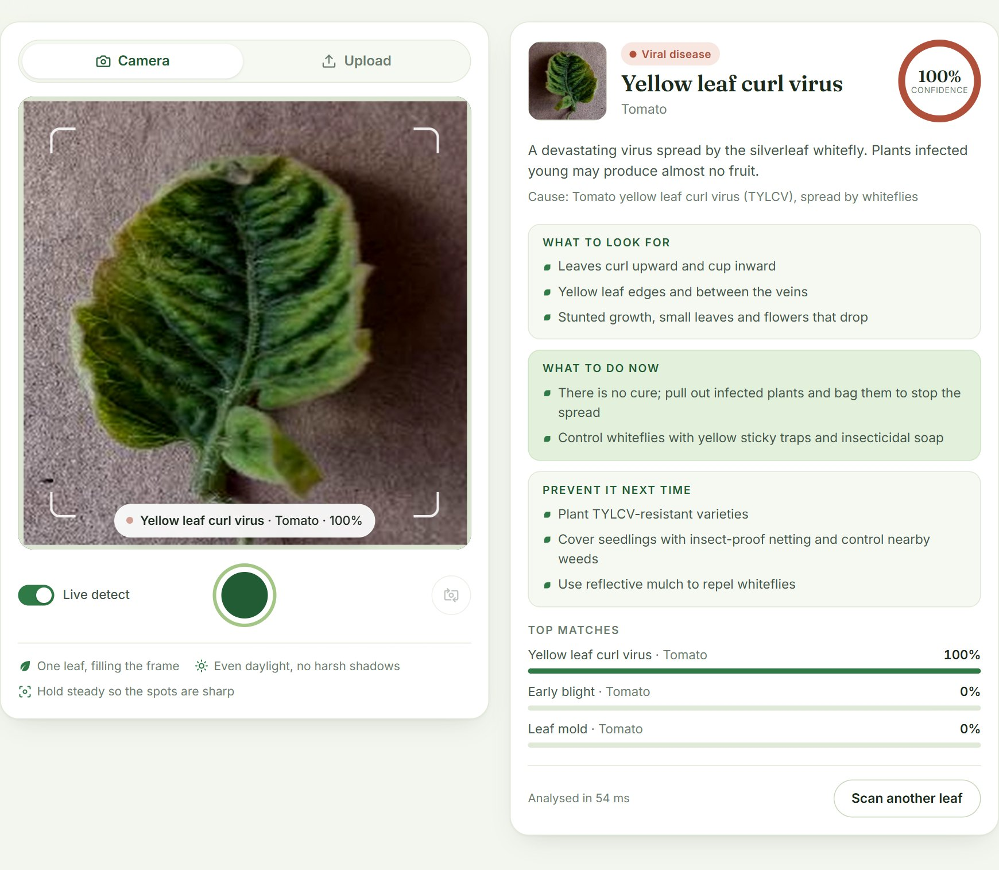

# LeafLens: Plant Disease Detection

[](https://github.com/DIVY3200/LeafLens/actions/workflows/ci-cd.yml)

Point your phone or laptop camera at a leaf and LeafLens tells you what's wrong with it, how sure it is, and what to do about it.

**Live demo: [leaflens-dsd1.onrender.com](https://leaflens-dsd1.onrender.com)** (free hosting: the first visit after a quiet spell takes about a minute to wake up).

The project follows **Moupojou et al., "FieldPlant: A Dataset of Field Plant Images for Plant Disease Detection and Classification With Deep Learning"** (IEEE Access, 2023). That paper shows that models trained on lab photos (PlantVillage) fail on photos taken in real fields. LeafLens reproduces the finding and fixes it the way the paper suggests: an ImageNet-pretrained MobileNetV2 trained on lab **and** field photos. It is right on **86.1% of held-out field photos** (the original model: 12.8%) and **96.2% of held-out lab photos**.



## Features

- **Camera capture.** Press **Open camera**, frame the leaf in the square guide and press **Take picture**. The photo freezes on screen and is diagnosed immediately. Press **Retake** to try again. Works with front and back cameras, and on phones you can also use the built-in camera app.
- **Live detect.** Toggle it on and the camera feed is classified continuously.
- **Upload, drag-and-drop or paste** an existing photo.
- **Useful results.** Symptoms to check, what to do now and how to prevent it next time, for every condition including the FieldPlant ones (cassava mosaic, maize streak virus, tomato blight and more).
- **Honest uncertainty.** Below 60% confidence the app says so and asks for a better photo.
- **Honest metrics.** The page shows the active model's accuracy on unseen lab photos *and* on real field photos, read from the model's card.
- **Scan history**, top-3 matches, phone-friendly layout and HTTPS mode for phone cameras.

## Results

Every number is measured on photos the model never saw in training.

| Model | Lab photos (PlantVillage) | Field photos (FieldPlant) |
|---|---|---|
| Original CNN, lab photos only | 95.5% (6,108 photos) | 12.8% (1,709 photos of conditions it knows) |
| **MobileNetV2, lab + field photos** | **96.2%** (8,819) | **86.1%** (490) |
| Paper: MobileNet, field photos only | – | 82.9% whole photos (Table 3), 85.6% cropped leaves (Table 4) |
| Paper: MobileNet, lab photos only | 99.2% | 61.9% whole photos, 36.6% cropped leaves |

On the same 165 held-out field photos of corn and tomato conditions that both models know, the original CNN named the right disease for 11.5% of them and the right crop for 59.4%; the new model gets 78.2% and 98.8%. It also knows when to doubt itself: 40% of its field mistakes come with the app's "not sure" warning (the original CNN's: 11%), while only 6% of its correct answers do. Both models get 31 of the 33 sample lab photos in `Dataset/old/test` right.

The comparison with the paper is indicative, not exact: the splits differ (LeafLens keeps burst shots and augmented copies of a leaf together), classes with too few photos are dropped here, and the paper scored whole photos as a multi-label task.

Per-class scores, the FieldPlant confusion matrix and the learning curves are in [reports/leaflens_mobilenetv2/](reports/leaflens_mobilenetv2/). The weakest spots are the field classes with few photos (corn stripe, corn brown spot and cassava brown leaf spot score F1 0.67–0.74) and healthy corn in the field, which is often mistaken for leaf blight.

Three findings about the data along the way:

1. **Lab-only training doesn't transfer to the field.** The original CNN was right on 12.8% of field photos, and most of its mistakes were confident, so the uncertainty warning rarely caught them.
2. **The original validation split leaks.** The "New Plant Diseases Dataset" was augmented *before* it was split, so 61% of its validation images are flipped or rotated copies of training leaves. The leak barely changed the score (96.1% reported, 95.5% on truly unseen leaves), but all evaluations here use leak-free splits.
3. **FieldPlant's own split leaks too.** 14–16% of its val and test photos were taken within the same minute as a training photo, often of the same plant, so the scripts re-split by photo group.

### What is implemented from the paper

| Paper | Code |
|---|---|
| Raw field photos (Table 3) and Cropped-FieldPlant leaves (Table 4) | `prepare_fieldplant.py` (format detected automatically) |
| MobileNet / VGG16 / InceptionV3 / InceptionResNetV2 with ImageNet weights | `train_transfer.py --backbone ...` |
| Train at lr 0.001, fine-tune at lr 0.0001, sparse categorical cross-entropy | `train_transfer.py` phases 1 and 2 |
| Cross-dataset benchmarks (Tables 3 and 4) and confusion matrix (Fig. 15) | `evaluate.py`, `reports/<model>/` |
| Learning curves with the fine-tuning boundary (Fig. 14) | `reports/<model>/history.png` |

Additions beyond the paper: combined lab + field training, field-style augmentation, class weights for FieldPlant's heavy imbalance, and leak-free group splits.

## Datasets

The datasets live in `Dataset/` (git-ignored):

```
Dataset/
  old/          New Plant Diseases Dataset (augmented PlantVillage): train/, valid/, test/
  FieldPlant/   FieldPlant photos: train/, val/, test/, each with one folder per class
```

| Dataset | Source | Size | Role |
|---|---|---|---|
| **FieldPlant**: 5,156 photos from Cameroonian plantations, 27 classes, labelled under plant pathologists (CC BY 4.0) | Kaggle, e.g. [`manhhoangvan/fieldplant`](https://www.kaggle.com/datasets/manhhoangvan/fieldplant) | 5.6–5.9 GB | field photos |
| New Plant Diseases Dataset (augmented PlantVillage, 38 classes) | [`vipoooool/new-plant-diseases-dataset`](https://www.kaggle.com/datasets/vipoooool/new-plant-diseases-dataset) | 2.9 GB | lab photos |

FieldPlant is published in two formats, and `prepare_fieldplant.py` detects which one it gets:

- **Class folders** (`train/val/test/<class>/*.jpg`, the version in `Dataset/FieldPlant`): one label per photo. Each photo is centre-cropped to a square, as the app does with camera photos. This is the paper's "raw images" setting (Table 3).
- **YOLO export** (`data.yaml` + `images/` + `labels/`): a box around every leaf. One image is cut per leaf, the paper's Cropped-FieldPlant (Table 4). `--crop-mode box` reproduces the paper's crops exactly; the default `square` keeps the background around the leaf.

The download's own train/val/test folders are not used: 14–16% of their val and test photos were taken within the same minute as a training photo, often of the same plant. The scripts re-split by photo group instead, the same way they keep augmented copies of a PlantVillage leaf together.

FieldPlant is very imbalanced: Corn Leaf Blight (1,079 photos), Cassava Mosaic (1,063) and Tomato Brown Spots (952) dwarf the rest. Nine classes have fewer than 40 training photos and are dropped (`--min-field-samples`), and the two non-leaf classes (cassava root rot, corn charcoal) are excluded. That leaves 47 classes: the 38 PlantVillage ones plus 9 field-only ones (cassava mosaic, brown leaf spot and healthy; maize streak, stripe, brown spot and yellowing; tomato blight and brown spots). Eight FieldPlant classes describe the same condition as a PlantVillage class and are merged into it, using the paper's own pairing (Fig. 15); the mapping is in [plant_disease/datasets.py](plant_disease/datasets.py).

## Train the field model

TensorFlow supports **Python 3.9–3.13**. On Windows with several versions installed, use for example `py -3.10` instead of `python`.

```bash
python prepare_fieldplant.py Dataset/FieldPlant     # ~1 min: 5,156 photos -> data/fieldplant
python train_transfer.py --pv-per-class 400         # MobileNetV2 on lab + field photos
python export_tflite.py                             # TensorFlow Lite copy for the server, checked to give the same answers
python app.py                                       # now uses models/leaflens_mobilenetv2.tflite
```

`train_transfer.py` saves the model, a JSON card (classes and test metrics, shown by the app), learning curves, a classification report and a FieldPlant confusion matrix in `reports/<model>/`. With `--pv-per-class 400` an epoch is about 19,000 images; on an 8-core laptop CPU each took 6–12 minutes, about 2.5 hours for the 19 epochs of the included model.

Keep the computer from sleeping while it trains. The best epoch so far is always checkpointed, so if a run is interrupted, run the same command again with `--finalize` to test and save that checkpoint without training again. That is how the included model was saved: the run was cut off during its 20th and last epoch, and epoch 19 was its best.

### Faster: a free Kaggle GPU

1. Create a Kaggle notebook, turn on the GPU accelerator and **Add data**: a FieldPlant dataset and `vipoooool/new-plant-diseases-dataset`.
2. Upload this project (or `git clone` it) into `/kaggle/working`, then run:

```bash
PV="/kaggle/input/new-plant-diseases-dataset/New Plant Diseases Dataset(Augmented)/New Plant Diseases Dataset(Augmented)"
python prepare_fieldplant.py /kaggle/input/fieldplant
python train_transfer.py --plantvillage "$PV/train" "$PV/valid"
```

3. Download `models/leaflens_mobilenetv2.keras`, `models/leaflens_mobilenetv2.json` and `reports/` into the project.

If the paths differ, `ls /kaggle/input` shows where Kaggle mounted the datasets. Models saved by a newer Keras may not load in an older one, so match your local TensorFlow to the notebook's (`print(tf.__version__)` there, then `pip install tensorflow==<that version>` locally).

### Reproduce the paper's experiments

```bash
python train_transfer.py --train-on plantvillage --out models/pv_only.keras   # lab only -> field
python evaluate.py --model models/pv_only.keras --plantvillage --split all    #   scored on every field photo
python train_transfer.py --train-on fieldplant --out models/fp_only.keras     # field only -> field
python train_transfer.py --backbone vgg16                                      # or inceptionv3, inceptionresnetv2
python evaluate.py --model trained_plant_disease_model.keras --plantvillage Dataset/old/valid --leak-free-against Dataset/old/train --split all --save
```

Every training run also tests on both datasets, so a lab-only model gets a field score and vice versa (classes a model was never taught are skipped and counted). The last command scores the original CNN on every FieldPlant photo and on the leak-free part of `valid/`, and writes the result to its card.

## Run the app

```bash
pip install -r requirements.txt
python app.py                         # http://localhost:5000
python app.py --model models/fp_only.keras
```

It uses `models/leaflens_mobilenetv2.keras` when it exists and the original CNN otherwise.

### Use it from your phone

Phone browsers only allow the live camera on HTTPS pages, so start the app with a self-signed certificate and open it to your network:

```bash
python app.py --host 0.0.0.0 --https
```

On a phone connected to the same Wi-Fi, open `https://<your-computer's-IP>:5000` (the terminal prints it), accept the certificate warning and allow camera access. If Windows Firewall asks, allow Python on private networks. Without `--https` the page still works, and the camera button falls back to the phone's own camera app.

## Testing and CI/CD

### Test levels

Every test is tagged with its level (pytest markers; an untagged test fails the run), and CI runs each level as its own step. The tests use tiny stand-in models and generated photos, so they need neither the datasets nor a GPU.

| Level | What it checks | Where | Tests |
|---|---|---|---|
| Static analysis | Syntax errors, undefined names, unused code (`ruff`) | whole repo | – |
| **Unit** | Leak-free grouping and splits, FieldPlant label mapping, every disease guide is complete, image resize identical to TensorFlow's, class weights, training history | `tests/test_datasets.py`, `test_knowledge.py`, `test_train_transfer.py` and parts of others | 68 |
| **Integration** | The web API end to end with a real model (bad and oversized uploads too), phone-photo rotation, both FieldPlant download formats through the prep script, TensorFlow Lite conversion | `tests/test_app.py`, `test_classifier.py`, `test_prepare_fieldplant.py` | 16 |
| **Model regression** | The shipped models load and match their cards; the deployed `.tflite` gives the same answers as the trained `.keras` | `tests/test_shipped_models.py` | 5 |
| **System (smoke)** | The production Docker container starts, answers `/api/health` and diagnoses a 12-megapixel photo | CI `docker` job | – |
| **Non-functional** | The running container stays under 400 MB, so it fits Render's free 512 MB instance | CI `docker` job | – |

```bash
pip install -r requirements-dev.txt     # Linux; on Windows install pytest and ruff next to requirements.txt
ruff check .
pytest                                  # all 89
pytest -m unit                          # or: -m integration, -m regression
```

### Pipeline

Every push and pull request runs [the workflow](.github/workflows/ci-cd.yml) on GitHub Actions:

1. **Lint and test:** `ruff`, then the unit, integration and model regression tests as separate steps.
2. **Build and smoke-test the Docker image:** the system and memory checks above.
3. **Deploy:** [Render](https://render.com) redeploys `main` once both jobs pass (`autoDeployTrigger: checksPass` in [render.yaml](render.yaml)), usually about 10 minutes after the push. `/api/health` reports which commit is live.

The deployed server runs the TensorFlow Lite export of the model on [LiteRT](https://pypi.org/project/ai-edge-litert/) instead of full TensorFlow: about 80 MB of memory instead of 430 MB and a 0.5-second start, with the same answers (tested on 93 real photos and in CI).

Run the production container locally (needs Docker):

```bash
docker build -t leaflens .
docker run -p 10000:10000 leaflens      # http://localhost:10000
```

### Deploy your own copy on Render

1. Sign up at [render.com](https://render.com) with your GitHub account (the free plan needs no card).
2. In the Render Dashboard choose **New > Blueprint**, connect GitHub and pick this repository. Render reads `render.yaml` and proposes a free web service called `leaflens`.
3. Click **Apply**. The first build takes a few minutes; the app then lives at `https://leaflens-<random>.onrender.com`.

Free Render services sleep after 15 minutes without visitors, so the first visit after a break takes about a minute.

## How it works

```
camera / photo ─► centre-crop to a square ─► 256×256 ─► POST /api/predict
                                                              │
     result card ◄── diagnosis + care info ◄── model (input size and classes from its card)
```

- **Same preprocessing everywhere.** Training and the app both feed raw 0–255 RGB, resized bilinearly from 256×256. Each model rescales internally, so any backbone works without changes to the app. Phone photos are rotated using their EXIF data.
- **Model cards.** `<model>.json` next to each `.keras` file stores the class list, the datasets used and leak-free test metrics.
- **Confidence threshold.** Predictions under 60% are reported as uncertain.

## API

```bash
curl -F "image=@Dataset/old/test/CornCommonRust1.JPG" http://localhost:5000/api/predict
```

```jsonc
{
  "prediction": {
    "label": "Corn_(maize)___Common_rust_", "plant": "Corn (maize)", "name": "Common rust",
    "healthy": false, "confidence": 1.0,
    "info": { "type": "fungus", "cause": "Puccinia sorghi", "summary": "...",
              "symptoms": [...], "treatment": [...], "prevention": [...] }
  },
  "top": [ { "label": "Corn_(maize)___Common_rust_", ..., "confidence": 1.0 }, ... ],
  "uncertain": false,
  "threshold": 0.6,
  "inference_ms": 29.9
}
```

`GET /api/health` reports the active model, its classes and its metrics.

## Project structure

```
app.py                         Flask web server and API
prepare_fieldplant.py          FieldPlant photos -> one-leaf crops (Cropped-FieldPlant)
train_transfer.py              transfer learning on lab + field leaves (the paper's recipe)
evaluate.py                    lab vs field accuracy, reports, model cards
plant_disease/
  classifier.py                loads a model and its card, preprocesses and classifies images
  datasets.py                  label mapping, leak-free group splits, dataset loading
  knowledge.py                 symptoms, treatment and prevention for every class
  layers.py                    custom Keras layer used by VGG16 models
templates/, static/            the web page, styles and camera/upload logic
train.py                       the original CNN training script (PlantVillage only)
train_plant_diseases.py        quick visual check of the original model on one image
trained_plant_disease_model.keras / .json    original CNN and its card
models/leaflens_mobilenetv2.keras / .tflite / .json   the field-trained MobileNetV2 (Keras and TensorFlow Lite) and its card
reports/<model>/               learning curves, classification report, FieldPlant confusion matrix
tests/                         unit, integration and model regression tests (pytest, run in CI)
export_tflite.py               converts a .keras model to TensorFlow Lite for the server
Dockerfile, requirements-deploy.txt          production container for the web app (LiteRT, no TensorFlow)
render.yaml                    Render Blueprint: free web service, deployed after CI passes
.github/workflows/ci-cd.yml    lint, test, Docker smoke test and deploy
```

## Limitations

- FieldPlant covers corn, cassava and tomato photographed in Cameroon. For the other 12 crops, the model has only lab photos to learn from, so its accuracy on field photos of them is unknown.
- A photo is classified as a whole. In a photo of several leaves, the model names one condition. Detecting each leaf first, as the paper proposes, needs the FieldPlant version with leaf boxes (YOLO format).
- Nine FieldPlant conditions with fewer than 40 training photos (for example corn smut and downy mildew) are left out until more data exists.
- LeafLens gives guidance, not a lab diagnosis. For serious outbreaks, check with a local agricultural extension service.
